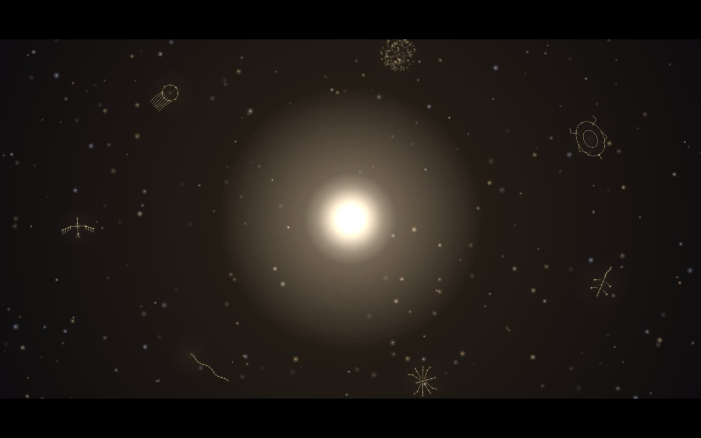
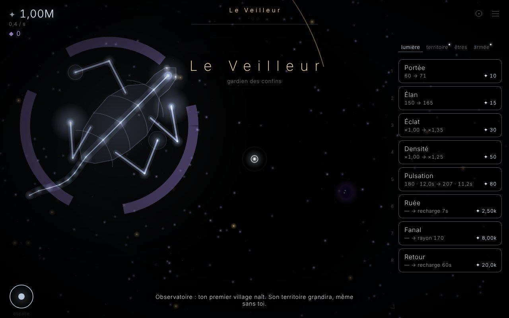
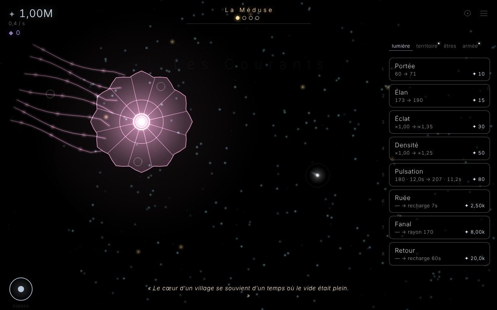
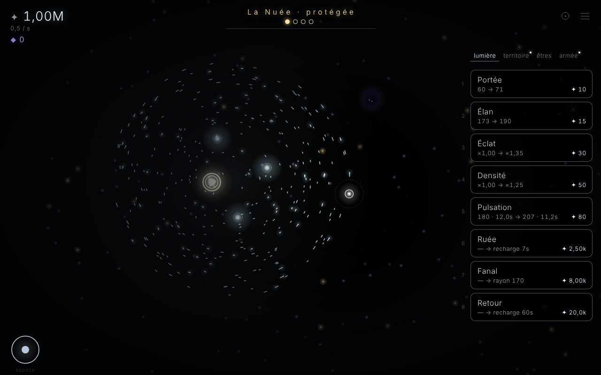
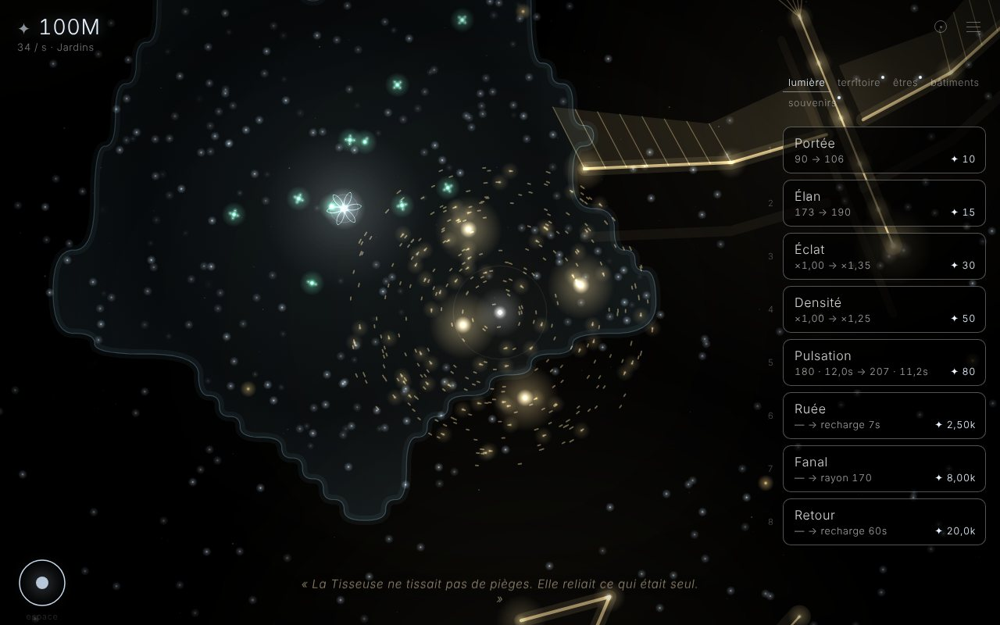

# Le Vide

Une lumière seule dans un vide infini, qui grandit.

Un jeu incrémental *interactif*, en français, en HTML / CSS / JavaScript pur, sans aucune dépendance :
tu ne regardes pas des chiffres monter, tu te déplaces, tu attires la lumière, tu pulses. Puis ton territoire
s'étend, même sans toi ; des êtres de lumière vivent, bâtissent et se défendent seuls ; et, aux confins,
des colosses immenses attendent d'être mérités.

Le vide était plein, autrefois : une lumière immense, entourée de colosses. Elle s'est brisée. Tu es ce qu'il
en reste — une lueur. L'histoire se raconte sans un mot, en tableaux, et par fragments, dans ton journal.



## Jouer

Ouvre `index.html` dans un navigateur. C'est tout.

| Action | Souris / tactile | Clavier |
| --- | --- | --- |
| Se déplacer | maintenir le clic ou le doigt | ZQSD, WASD ou flèches |
| Pulsation | bouton rond | Espace |
| Acheter | clic sur une carte | 1 à 9 (Tab : onglet suivant) |
| Ordres de l’armée | barre sous le compteur | G garder · E escorter · C chasser · B assiéger |
| Carte | ◎ en haut à droite | M |
| Zoom | molette, pincement à deux doigts | + / − |
| Capacités : ruée, fanal, retour | petits boutons au-dessus de la pulsation | Maj, F, R |
| Expéditions : éclaireurs, colons, érudits, sapeurs | toucher un point de la carte | — |
| Passer un tableau | toucher l'écran | Échap, Espace, Entrée |
| Menu / pause, options, journal | ≡ en haut à droite | Échap |

La partie est sauvegardée automatiquement dans le navigateur ; le monde continue pendant ton absence.
Depuis le menu, tu peux l'**exporter** en un code (pour la garder ou changer d'appareil) et l'**importer**.

## Ce qui t'attend

- **La récolte** : la lumière flotte dans le vide ; attire-la, pulse pour tout attraper d'un coup.
- **Les villages** : fonde-les où tu veux, du type que tu choisis (jardins, bastion, atelier, observatoire,
  sanctuaire). Chacun a son territoire vivant, qui pousse vers ses bâtiments et grandit lentement, toujours,
  même sans toi ; son cœur blanchit avec le temps, en cinq nuances, jusqu'au blanc pur.
- **Sous-factions** : à chaque fondation, tu choisis le type du village et sa sous-faction — Éleveurs, Illuminés ou
  Lames — et tu la changes quand tu veux. Un village né d'un autre en hérite, ou mute. Les bases d'ombre ont les
  leurs : Dévoreurs, Corrupteurs, Meutes.
- **Des villes en étoile** : chaque village suit son plan — boulevards en anneaux, quatre avenues vers quatre
  portes, des îlots où chaque bâtiment prend sa place selon son rôle. Entoure-le d'**enceintes** : elles
  arrêtent tout sauf les colosses, leurs portes ne s'ouvrent qu'à la lumière, et les ombres doivent les abattre.
- **Les êtres** : dans chaque village, des lueurs récoltent le jardin, des bâtisseurs choisissent où construire
  nids, prismes, phares, tours et bien d'autres ; ils se croisent, dansent, ravitaillent les chantiers.
  Confie une part de lumière à l'**intendant** d'un village : il le fait grandir seul.
- **Routes, échanges, cités** : relie tes villages par de grandes routes de lumière, qui partent des portes et
  partagent un tronc quand elles sortent ensemble ; des caravanes y portent la
  matière ◇ des ateliers, le savoir ✎ des observatoires, les soldats des bastions. Quand deux territoires se
  touchent, ils fusionnent en une cité qui garde toutes leurs spécialités.
- **Expéditions et capacités** : depuis la carte, envoie des éclaireurs révéler le lointain, des colons fonder
  au loin, des érudits étudier un colosse, des sapeurs bâtir balistes et chaînes — escortés si tu veux. Ta
  lumière apprend la ruée, le fanal et le retour.
- **Les ombres bâtissent** : des bases d'ombre, en négatif de tes villages — un territoire de noirceur en cinq
  nuances, des fosses, des flèches qui tirent sur la lumière, des remparts qu'elle doit abattre — lancent des raids sur tes
  villages. Assiège-les avec ton armée, détruis leur cœur, et la région redevient une clairière.
- **Les créatures** : loups, scolopendres, cerfs de lumière — de grands corps articulés. À bout de forces, une
  créature est apprivoisée, purifiée ou corrompue selon la sous-faction de qui l'abat, et change de camp. Dans le
  vide errent des lucioles, des raies de lumière, une baleine ; des convois roulent sur tes routes.
- **Les ombres** : des marées attirées par ta lumière. Ta pulsation les blesse ; une armée automatique
  (gardiens, étincelles, veilleuses, harponneurs) obéit à tes ordres. Les ombres vaincues laissent des échos ◆.
- **Les zones** : Calme, Brume, Courants, Murmure, Éclat, Gouffre — plus loin, plus riche, plus dangereux.
- **Les colosses** : le Veilleur, la Tisseuse, le Léviathan, l'Oiseau d'aube, la Méduse, la Nuée et le Dormeur,
  immenses, chacun à sa manière. Fais étudier leurs sceaux voilés par tes érudits, esquive leurs attaques
  annoncées, brise leurs sceaux phase après phase, fais-les plier avec ton armée, tes balistes et tes chaînes…
  Ils marchent parfois sur tes villages. Apaisés, ils défendent, tissent, portent, accompagnent, soignent,
  rabattent la lumière — et le dernier te laisse bâtir sur son dos.
- **La renaissance** : te dissoudre pour renaître avec des souvenirs ✧ et des bienfaits éternels.
- **Les tableaux** : des cinématiques peintes en code, sans un mot — l'ouverture, chaque rencontre, chaque
  apaisement, la renaissance, et un épilogue.
- **Le son et le récit** : tout est synthétisé en direct ; des fragments d'histoire se révèlent au fil du jeu.

## Captures

| | |
| --- | --- |
|  |  |
|  |  |

## Publier sur GitHub Pages

Settings → Pages → *Deploy from a branch* → `main` / `(root)`.
Le jeu sera disponible à `https://<utilisateur>.github.io/<dépôt>/`.

## Développement

```
node tests/run.js                         # tests de la logique (aussi : ouvrir tests/tests.html)
node tests/smoke.js                       # test de fumée dans Chromium (nécessite Playwright)
node tests/balance.js 60                  # robot d'équilibrage : une heure de jeu simulée
node tests/balance.js 120 --renaissance   # … avec renaissances, vie après vie
node tests/duel.js                        # robot duelliste : chaque colosse est-il apaisable ?
```

```
index.html, style.css
src/core/   logique pure, sans navigateur — entièrement testée
src/app/    affichage (canvas), contrôles, interface, son, stockage
tests/      tests, test de fumée, robot d'équilibrage
```

La méthode de travail et les règles d'architecture sont dans [CLAUDE.md](CLAUDE.md),
l'historique dans [CHANGELOG.md](CHANGELOG.md), la feuille de route dans [ROADMAP.md](ROADMAP.md).
